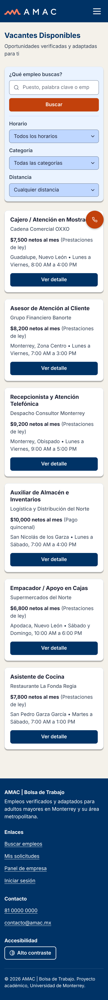
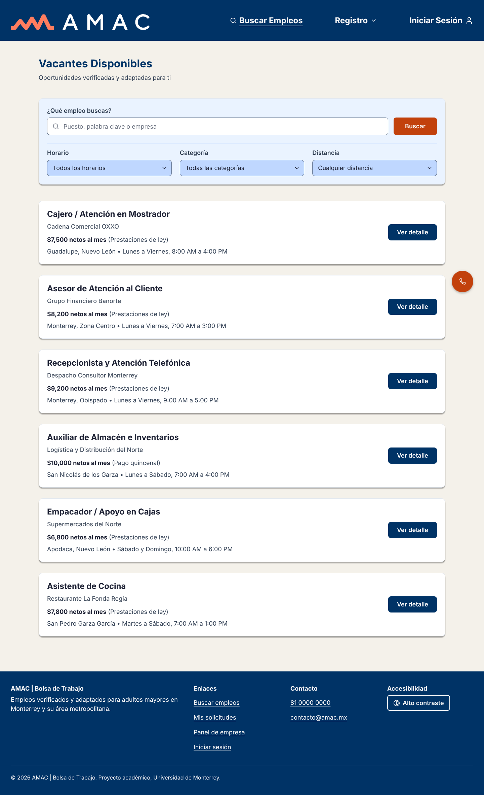
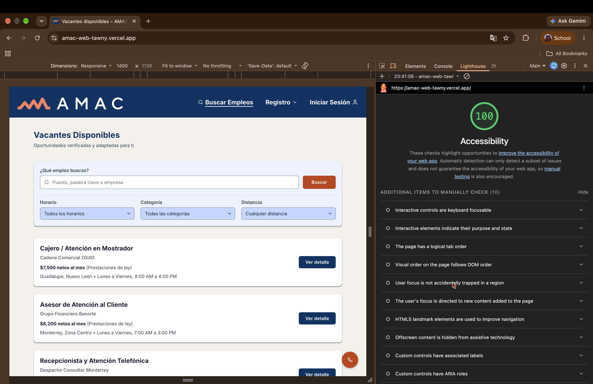

# AMAC | Bolsa de Trabajo

Plataforma web de empleo para **adultos mayores** en Monterrey y su área metropolitana. Esta entrega convierte el prototipo de Figma en un sitio estático con **HTML semántico y CSS puro**, mobile-first y accesible.

- **Sitio publicado:** https://amac-web.vercel.app
- **Repositorio:** https://github.com/USUARIO/amac-web
- **Prototipo en Figma:** https://www.figma.com/design/YXIvKzFADCwxvVKd1LbgfI

> Materia: Desarrollo de Aplicaciones Web · Entrega 2 (HTML + CSS) · Universidad de Monterrey

---

## Integrantes

| Integrante | Aportaciones |
|---|---|
| **Iker** | Estructura de carpetas y `variables.css` (tokens de Figma en `rem`); encabezado, pie y botón de ayuda unificados en todas las páginas; `index.html` (buscador, filtros y listado); metadatos y favicon; README. |
| **Ricardo** | `base.css` (reset, texto base de 18 px, foco visible, “saltar al contenido”); `vacante.html` con botón Llamar; ventana de confirmación de postulación; estilos de impresión y de colores forzados; modo de alto contraste. |
| **Josue** | `layout.css` (contenedor, menú hamburguesa, pie, botón flotante); `login.html`; `registro-candidato.html` con grupos de campos y dirección; inicio de sesión de empresa y menú “Iniciar Sesión”; página 404. |
| **Edson** | `componentes.css` (botones, estatus, campos, tarjetas y tablas); `mis-solicitudes.html` con botón Cancelar; `empresa-vacantes.html`; registro de empresa y menú “Registro”; solicitudes recibidas con estado vacío. |

El detalle de cada aportación está en el historial de commits del repositorio.

---

## Páginas

| Página | Contenido | Requisitos |
|---|---|---|
| `index.html` | Listado de vacantes con buscador y filtros (horario, categoría, distancia) | RF-001, RF-002, RF-007 |
| `vacante.html` | Detalle de la vacante, botón **¡Quiero Postularme!** con confirmación y botón **Llamar a la empresa** | RF-003, RF-004, RF-051 |
| `login.html` | Inicio de sesión del candidato | RF-008 |
| `registro-candidato.html` | Registro con datos personales, contacto, dirección, experiencia y aceptación de términos | RF-011, RF-012, RF-013 |
| `mis-solicitudes.html` | Solicitudes del candidato con 3 estatus distintos y botón **Cancelar** | RF-005, RF-006 |
| `empresa-vacantes.html` | Panel de la empresa: vacantes publicadas y candidatos postulados | RF-019, RF-020, RF-021 |
| `registro-empresa.html` ★ | Registro de empresa (razón social, RFC, correo, teléfono, giro) | RF-015, RF-016 |
| `login-empresa.html` ★ | Inicio de sesión de empresa | RF-008 |
| `solicitudes-recibidas.html` ★ | Revisión de candidatos con Aceptar, Agendar entrevista y Rechazar, con confirmación y **estado vacío** | RF-022, RF-023, RF-024 |
| `404.html` ★ | Página de error con regreso al inicio y teléfono de ayuda | — |

★ Páginas opcionales (puntos extra). Además, todas las páginas tienen **modo de alto contraste**.

En todas las páginas: encabezado con navegación, pie de página y botón flotante para **llamar a AMAC** (RF-052).

**Flujo de la demo:** `index.html` → **Ver detalle** → **¡Quiero Postularme!** → **Ir a Mis Solicitudes**.
Flujo de empresa: **Iniciar Sesión → como empresa** → **Acceder al panel** → **Ver** candidato → **Aceptar candidatura**.

---

## Estructura del proyecto

```
amac-web/
├── index.html
├── vacante.html
├── login.html
├── login-empresa.html
├── registro-candidato.html
├── registro-empresa.html
├── mis-solicitudes.html
├── empresa-vacantes.html
├── solicitudes-recibidas.html
├── 404.html
├── css/
│   ├── variables.css     ← colores, tipografía, espaciados y modo alto contraste
│   ├── base.css          ← reset, body, tipografía, enlaces, foco, utilidades
│   ├── layout.css        ← encabezado, menú, pie, contenedor, botón de ayuda
│   └── componentes.css   ← botones, tarjetas, formularios, tablas, estatus
├── js/
│   └── main.js           ← opcional: menú móvil, contraseña, ventanas, alto contraste
├── img/
│   ├── amac-logo.png
│   ├── favicon.svg
│   └── capturas/
└── README.md
```

El orden de carga en cada página es `variables.css → base.css → layout.css → componentes.css`. No se usa ningún framework (ni Bootstrap ni Tailwind) ni estilos en línea (`style=""`).

---

## Paleta de colores

Definida en `css/variables.css`. Contraste calculado con la fórmula de WCAG 2.x.

| Variable | Color | Uso | Contraste |
|---|---|---|---|
| `--color-fondo` | `#F4F1EA` | Fondo de todas las páginas (blanco hueso) | — |
| `--color-primario` | `#003366` | Encabezado, títulos, botones de consulta (Ver detalle, Acceder) | 12.6:1 con blanco |
| `--color-accion` | `#C2410C` | Acciones importantes (Buscar, Postularme, Agendar entrevista, Llamar) | 5.2:1 con blanco |
| `--color-exito` | `#166534` | Entrevista agendada, candidatura aceptada | 7.1:1 con blanco |
| `--color-peligro` | `#991B1B` | Rechazar, No seleccionado | 8.3:1 con blanco |
| `--color-panel` | `#EAF3FF` | Panel del buscador y detalle de vacante | — |
| `--color-texto` | `#334155` | Texto normal | 9.2:1 sobre fondo |
| `--color-texto-suave` | `#4A5565` | Subtítulos y nombre de empresa | 6.7:1 sobre fondo |
| `--color-texto-placeholder` | `#6B7280` | Texto de ejemplo en campos | 4.8:1 sobre blanco |
| `--color-borde-campo` | `#64748B` | Borde de inputs y selects | 4.8:1 (mínimo 3:1) |
| `--color-foco` | `#C2410C` | Anillo de foco sobre fondos claros | 4.6:1 |
| `--color-foco-sobre-oscuro` | `#FDBA74` | Anillo de foco en encabezado y pie | 7.5:1 |

**Estatus:** En revisión `#9A3412` / `#FFEDD5` · Entrevista `#166534` / `#DCFCE7` · No seleccionado `#991B1B` / `#FEE2E2` (todos ≥ 6.3:1).

La decisión de diseño #3 de la Entrega 1 se mantiene: **azul** para consultar, **naranja** para acciones importantes, **verde** para aceptar y **rojo** para rechazar.

---

## Tipografía y medidas

- **Fuente:** Inter (Google Fonts), pesos 400, 500, 600 y 700, con respaldo `system-ui`.
- **Texto base:** `1.125rem` (18 px). Ningún texto de lectura baja de 18 px; solo apoyos breves usan 16 px.
- Todos los tamaños de texto y espacios están en `rem`, así que escalan con la configuración y el zoom del navegador.

| Variable | Celular | Tablet y escritorio | Uso |
|---|---|---|---|
| `--texto-base` | 18 px | 18 px | Párrafos, campos, botones |
| `--texto-xl` | 20 px | 24 px | Títulos de tarjeta, menú |
| `--texto-2xl` | 22 px | 26 px | Títulos de sección (h2) |
| `--texto-3xl` | 26 px | 32 px | Título de página (h1) |
| `--texto-4xl` | 28 px | 36 px | Título del detalle de vacante |

- **Espaciados:** escala de 4 px en `rem` (`--espacio-1` = 4 px … `--espacio-24` = 96 px).
- **Áreas táctiles:** `--tactil-min` = 44 px; botones de 48 px y campos de 52 px de alto.
- **Puntos de quiebre:** 48em (768 px), 64em (1024 px), 80em (1280 px, menú de escritorio) y 90em (1440 px).

---

## Componentes reutilizables

Cada clase de `componentes.css` será un componente de React en la Entrega 3.

| Clase CSS | Componente React | Dónde se usa |
|---|---|---|
| `.btn` (`--accent`, `--success`, `--danger`, `--danger-soft`, `--outline`, `--lg`, `--block`) | `<Boton />` | Todas las páginas |
| `.icon` | `<Icono />` | Navegación, campos, botones |
| `.tag` / `.status` | `<Etiqueta />` / `<EtiquetaEstatus />` | Tablas, tarjetas de candidato |
| `.stats` / `.stat` | `<Estadistica />` | Mis solicitudes, panel, solicitudes recibidas |
| `.field` | `<CampoFormulario />` | Login y registros |
| `.choice` | `<OpcionRadio />` | Registro de candidato |
| `.notice` + `.disclosure` | `<AvisoTerminos />` | Registros |
| `.search-panel` / `.filter` | `<Buscador />` / `<Filtro />` | Listado |
| `.job-card` | `<TarjetaVacante />` | Listado |
| `.job-detail` | `<DetalleVacante />` | Detalle |
| `.auth-card` | `<FormularioAuth />` | Login y registros |
| `.data-table` | `<TablaDatos />` | Mis solicitudes, panel de empresa |
| `.candidate-card` | `<TarjetaCandidato />` | Solicitudes recibidas |
| `.modal` | `<VentanaConfirmacion />` | Postulación y decisiones de la empresa |
| `.empty-state` | `<EstadoVacio />` | Solicitudes recibidas |
| `.info-note` / `.help-link` | `<NotaInfo />` / `<EnlaceAyuda />` | Mis solicitudes, formularios |
| `.site-header` / `.site-footer` / `.help-fab` | `<Encabezado />` / `<Pie />` / `<BotonAyuda />` | Todas las páginas |

---

## Accesibilidad

| Requisito (sección 4.2) | Cómo se cumple |
|---|---|
| Texto base ≥ 18 px en `rem` | `body { font-size: var(--texto-base) }` = `1.125rem` |
| Contraste ≥ 4.5:1 | Paleta verificada (tabla de arriba). Se ajustaron el placeholder y el borde de los campos respecto a Figma. |
| Botones y enlaces ≥ 44 × 44 px | `--tactil-min`, `min-height` en botones, enlaces del menú, del pie y el botón de mostrar contraseña |
| `<label for>` visible en todo input | Incluido el buscador; las opciones de radio y la casilla de términos están dentro de su `<label>` |
| `alt` en imágenes | El logo tiene `alt` descriptivo; los íconos son SVG con `aria-hidden="true"` |
| Foco visible | `:focus-visible` con anillo de 3 px; color claro sobre el encabezado azul |
| Un `<h1>` y jerarquía en orden | h1 → h2 → h3 → h4 en todas las páginas |
| `lang="es"` y `viewport` | En todas las páginas |
| Zoom al 200 % sin scroll horizontal | Contenedores con `width: min(...)`, sin anchos fijos ni `white-space: nowrap` en textos |

**Además:**
- Enlace **“Saltar al contenido principal”**.
- Las tablas se convierten en tarjetas con etiquetas en celular.
- Las ventanas de confirmación usan `<dialog>`: atrapan el foco, cierran con Esc y devuelven el foco al botón.
- Soporte para `prefers-reduced-motion`, `prefers-contrast` y colores forzados de Windows.
- Estilos de impresión.
- **Modo de alto contraste** desde el pie de página, que se guarda entre visitas.
- El sitio funciona sin JavaScript: el menú se muestra abierto y las ventanas se abren con `:target`.

---

## Cambios respecto al prototipo de Figma

| Cambio | Motivo |
|---|---|
| Etiqueta visible “¿Qué empleo buscas?” en el buscador | El placeholder solo no basta (requisito 4.2) |
| Placeholder `#94A3B8` → `#6B7280` y borde de campos `#CBD5E1` → `#64748B` | Los originales daban 2.6:1 y 1.5:1 de contraste |
| Casilla de términos de 18 → 24 px y botón de ver contraseña de 20 → 44 px | Área táctil mínima |
| Texto de 16 px en celular → 18 px | Figma lo reducía en móvil; el mínimo es 18 px |
| Menú hamburguesa hasta 1280 px | El logo y el menú de Figma no caben juntos entre 1024 y 1280 px |
| Logo de 200 px en celular | El de 301 px no cabe en 320 px junto al botón de menú |
| Botón flotante de llamar en todas las páginas | Faltaba en el detalle y en el panel de empresa (RF-052) |

---

## Capturas

**index.html en celular (390 px)**



**index.html en escritorio (1440 px)**



**Lighthouse – Accessibility (index.html)**



---

## Verificación

- **Validador W3C** (validator.w3.org): 0 errores en las 10 páginas.
- **Lighthouse – Accessibility:** 100 en `index.html`.
- **Teclado:** todas las páginas se recorren con Tab, Shift+Tab, Enter y Esc, y el foco siempre se ve.
- **Zoom al 200 %:** sin texto cortado ni scroll horizontal.
- **Tamaños:** revisado en 320, 768, 1024 y 1440 px.

---

## Cómo verlo

- **En línea:** abrir la URL de Vercel de arriba.
- **En local:** abrir `index.html` en el navegador; no requiere instalar nada.

Cada `git push` a `main` vuelve a publicar el sitio en Vercel automáticamente.
